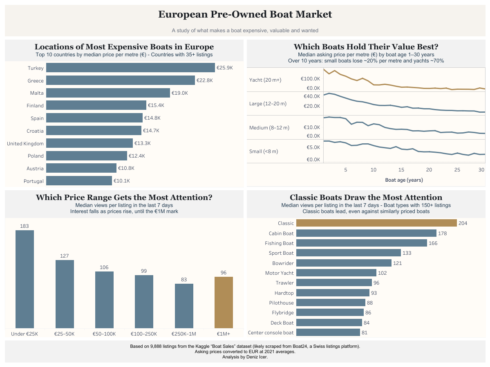

# European Pre-Owned Boat Market

**What defines a boat's price, value and desirability?**

An analysis of 9,888 second-hand boat listings across Europe, exploring how location, size, age and boat type relate to asking prices and buyer interest.

🔗 **[View the interactive dashboard on Tableau Public](https://public.tableau.com/views/EuropeanPre-OwnedBoatMarket/Dashboard1)**

## Main Insights
- Turkiye, Greece and Malta show the highest median asking prices per metre (€19–26K).
- Depreciation increases with vessel size: over 10 years, small boats lose ~20% per metre, yachts ~70%.
- Entry-level listings receive the most views, yet interest rebounds above €1M, suggesting a dream-buyer effect.
- Classic boats attract the most views, even compared with similarly priced boats.

## Data Preprocessing (Python, pandas)
Fixed character-encoding errors, standardized four currencies into EUR using 2021 average exchange rates, flagged missing build years, parsed countries from free-text location data, separated merged fields, and engineered age and price-per-metre metrics.

## Limitations
Data reflects asking prices, not actual sales. Views cover a single week and likely skew toward Central European buyers, as the data appears to come from a Swiss listings platform.

## Files
| File | Description |
|---|---|
| `boat_data_raw.csv` | Original dataset from Kaggle |
| `clean_data.ipynb` | Python notebook with all cleaning steps |
| `boat_data_clean.csv` | Cleaned dataset used in Tableau |
| `boat_market_dashboard.twbx` | Tableau packaged workbook |
| `Dashboard.png` | Dashboard preview |

## Tools
Python (pandas, Google Colab) · Tableau Public

**Data:** Kaggle "Boat Sales" dataset · **Author:** Deniz Icer
